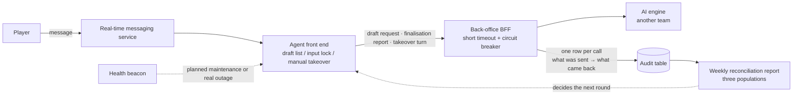

## Background

Customer-service agents used to type every reply by hand. This project wove "the AI drafts, a human reviews and sends" into the existing customer-service system: the AI never speaks to players directly, and an agent can send a draft as is, rewrite it, or take over and reply manually.

The AI engine belongs to another team. My part was connecting it to the existing real-time messaging path: the agent front end, the back-office BFF, and the degradation and measurement between them.

This page is not organised around features. The features were finished on launch day. The three months after that were **eight rounds of iteration**, and what each round had to fix was almost never reported by a person. It surfaced from an audit table.

## Architecture



There are three kinds of call to the AI engine: a **draft request** (a player spoke, ask for a draft), a **finalisation report** (after the agent sends, report whether the draft was used verbatim or what was changed), and a **takeover turn** (a purely manual reply after the agent takes over). The finalisation report is what the engine learns from, and several rounds below revolve around it.

## The precondition for iterating: instrument on launch day

After every call to the engine, the BFF writes one row to an audit table: which conversation, which draft, which agent, what status the engine returned, plus **the full payload that was sent** and **the engine's raw error text**. The write never blocks the main flow; a failure only logs a warning, and a switch can turn it off temporarily.

The table serves two purposes. First, the customer-service team reconciles numbers every week and keeps changing the spec, so our side has to produce its own figures instead of reading only their dashboard. Second, **silent failures do not announce themselves**: the call still returns, the screen still works, nobody reports anything. The anomaly only shows once successes and failures are grouped by condition.

## Eight rounds

| Round | What was found | How it was found | What changed |
|---|---|---|---|
| 1 | Finalisation reports for rewritten drafts were **rejected by the engine 100% of the time** | Grouping response status by "sent verbatim / sent rewritten" gave a clean split with no exceptions | Added the channel for rewrite-reason labels |
| 2 | **127 of 136 conversations (93%) had entered manual takeover** | The "composition of sent replies" breakdown in the reconciliation report | Applying a canned reply now counts as a correction; no draft means no takeover |
| 3 | "The engine supports it" in the spec did not mean it was deployed | A contract-check command that fires the spec's example payloads at the engine | Re-verified after the engine deployed, 12/12 passed |
| 4 | The spec replaced five categories and seventeen sub-items of rewrite reasons with six categories | Section-by-section diff of old and new spec | Outgoing format changed to match |
| 5 | Ratings for "looked at the draft and chose not to use it" during takeover were lost wholesale | Derived from the data: **350 of 894 takeover turns still had a draft in hand** | With a draft, send a finalisation report; without one, a takeover turn |
| 6 | One player flooding the chat could overwhelm an agent's browser | After an agent report, the audit table showed 107 calls all successful, so the problem was in the front end | Draft-list cap plus throttling for that conversation |
| 7 | Round 6's throttling left a gap at the tail of a flood | The engine team raised a question; message timestamps were compared one by one | Scheduled calls are kept when a batch ends |
| 8 | Opening a conversation sent only the last message to the AI | Per-message timestamps supplied by the engine team | Now backfills the whole unread batch since the agent's last reply |

None of the first five rounds came from an agent report or a manual inspection. The last three were raised from outside, but locating the problem still relied on the same table.

### Round 1: every agent correction had never arrived

Three days after launch, finalisation reports were grouped by whether the agent had rewritten the draft: all 17 sent verbatim succeeded, and all 29 sent rewritten **failed**.

The engine's contract requires a rewrite-reason label whenever a report says the draft was rewritten, and our side had never sent that field. Because the finalisation report is best effort and a failure does not stop the agent's message from going out, every correction an agent had made to an AI draft since launch had failed to reach the engine. The learning loop had not turned once on this path.

The audit table stores the engine's raw error text, so there was nothing to guess and nobody to ask.

### Round 2: 93% of conversations were "taken over"

Broken down by composition, there were 643 takeover turns and only 46 finalisation reports. 127 of 136 conversations had entered takeover, which looked as if the AI was barely being used.

The cause was an old design: when an agent picked a canned reply, the system treated it as "taking over manually". Once the customer-service team ruled that applying a canned reply is a kind of correction to the draft, it was rebound to the finalisation report. Had the 93% never been measured, nobody would have seen it as a problem.

The reconciliation report deliberately shows three populations: all agent replies, the composition of sent replies, and the serviceable count after removing messages the engine itself flagged as needing a human. The same data tells opposite stories under different denominators, so the denominator is agreed before any number is compared.

### Round 5: an honest denominator makes the metric go down

After taking over, an agent often still has a draft in hand and simply chooses not to use it. Those replies went out as takeover turns with no draft id, so the judgement "the agent rejected this draft" was never recorded. Working backwards from the data, 350 of 894 takeover turns were of this kind.

After the fix, evaluation-metric coverage rose from 56% to nearly 100%. The side effect is that the AI's adoption rate drops, because all 350 are rejections that had been systematically left out of the denominator. The people reading the report were told this before the next reconciliation, since it would otherwise read as the AI getting worse.

### Round 6: merging did nothing, and the first safeguard oscillated

An agent reported "the AI is broken again; logging in again fixes it." The audit table came first: 107 calls in that window, all successful, zero back-end errors. The engine and the back office were fine, so the problem was in the browser. The draft list lives only in memory, which also explains why logging in again helped.

What had happened: one player sent 113 messages in 14 minutes, one every 7 seconds, and over a hundred drafts piled up in a single conversation.

Two points ran against intuition:

- **Debouncing could not stop it.** Messages merge when they arrive within 3 seconds of the previous one, and this player sent one every 7 seconds, so each message formed its own batch. The window has to be longer than the sender's rhythm for merging to happen at all.
- **Merging reduces the number of drafts, not the number of calls.** Each incoming message triggers a fresh request with the merged content, so even a successful merge does not lower the call count.

The fix has two parts: cap the draft list at 10 (drafts being merged or already applied are never dropped), and when a conversation receives more than 6 player messages within 60 seconds, stretch the minimum interval between calls to 15 seconds. Only that conversation is limited; normal conversations are untouched.

The first version of the throttle used **its own call count** as the flooding signal, which produced this:

```log
throttle engages → calls in the window fall below the threshold → throttle releases → full speed again → triggers again
```

The control action erased its own detection signal. The simulation only dropped from 107 calls to 83, which is how the problem was noticed. Switching to **the player's message rate** (which my throttling cannot change) settled it at 56.

Behaviour like this cannot be reproduced by normal use, so I wrote a simulator that loads the shipped code directly (not a copy made for testing) and replays the same rhythm against a virtual clock.

### Round 7: three weeks later, the gap was dug by my own safeguard

Another flood, this time a different player: 34 messages in 48 seconds. The engine team asked first: after a certain moment the back office made no calls for more than two minutes, so what blocked them?

Comparing timestamps message by message gave a split answer:

| Their question | What the data showed |
|---|---|
| No calls for over two minutes | **Not supported.** The player had stopped sending at that moment |
| The back office blocked calls | **Partly supported.** The last 7 messages before the player stopped never got a draft |

The cause sat in the throttle I had added in round 6. The last 7 messages scheduled a call for 15 seconds later, but 3 seconds after the player stopped, the "batch ended" clean-up cancelled every call that had not yet fired. The throttle and the clean-up were each correct; the gap was where they met.

My first fix was to fire immediately when a batch ends. Replaying round 6's rhythm as a regression test sent the call count back up to 113, which cancels the throttle entirely. The right fix lets the scheduled call run at its original time, neither earlier nor cancelled.

The first simulator could not see this gap because it loaded only the two functions I believed were relevant and never ran the batch-end path, which is exactly where the problem lived. It became visible once the second version wired up the full batch lifecycle. Both mistakes were the same kind: the simulated scope was smaller than the real system.

### Round 8: the wrong name sends everyone to the wrong place

The engine team reported "the AI cannot read the player's first sentence" and described it as "the player sending several messages in a row". But the gaps in their example were 5 and 7 seconds, both longer than the merge window, so those messages would never have been one batch.

The real condition: while the conversation was not open, the player accumulated several unread messages, and at the moment the agent opened it only the last one was sent to the AI. It has nothing to do with spacing; messages ten minutes apart are lost just the same.

Calling it "sending in a row" pushes people toward the flood protection, where nothing is wrong. Once it was renamed "unread backfill", the acceptance test changed with it: the case to test is "send slowly, with the conversation closed", not rapid-fire messages.

## When a draft is produced: three situations, three mechanisms

These are easily taken for one thing. The engine team and I each made that mistake once.

| Situation | Mechanism | Parameters | Depends on message spacing |
|---|---|---|---|
| Conversation open, normal messages | Debounced merging: once the player goes quiet, the run is treated as one message | Collect after 3 s of silence, wait at most 10 s | Yes |
| Conversation open, player flooding | The same path with two safeguards: throttling and a draft cap | More than 6 messages in 60 s → minimum interval 15 s; list capped at 10 | Yes |
| Conversation closed, unread piling up | Unread backfill: on open, send the whole unanswered batch | Back to the agent's last reply, with caps on count and length | No |

## Before and after

| Metric | Before the fixes (first week after enabling) | After (following week) |
|---|---|---|
| Finalisation-report failure rate | **62.5%** (55/88) | **8.6%** (109/1,268) |
| Finalisation reports in total | 88 | **1,268** |
| AI drafts sent verbatim | 33 | **326** |
| Evaluation-metric coverage | 56% (449/799) | Nearly **100%** |

What still cannot be measured: the second and third replies after a takeover have no draft to compare against. They make up 60% of takeover turns, and the engine cannot learn from them. The customer-service team knows and accepts this, because forcing them into the metric would only manufacture false "AI failures".

## Degradation design

The AI engine's response time is unstable, and it gives no notice when under maintenance. When the new mechanism breaks, the original customer-service flow has to keep working.

| Case | Handling |
|---|---|
| Engine is slow | Draft requests use a 9-second timeout; accumulated failures open the circuit breaker so the front end is not held up |
| Engine under maintenance | A "server not responding" reply unlocks manual input immediately, without waiting for the breaker threshold |
| Maintenance or outage is unclear | A separate health beacon is queried, and the error message states the observed facts (beacon reachable, maintenance flag off, draft request failing) instead of "service error, contact an engineer" |
| The new takeover binding is missing or its table does not exist | Every lookup is wrapped in exception handling; on a miss, the original four-level dispatch logic runs unchanged |
| Engine returns an empty draft | Explanatory text is shown and "apply" is not offered; the engine's reason code is matched by prefix, so unknown new values fall through to a generic notice |

The fourth row was proven in production: the code went out before the table was created, leaving a window in which the table did not exist, and no agent on shift reported anything unusual. That window should not have existed, though. The table should be created first; the degradation caught it, which does not make the process correct.

## Freezing a baseline before enabling

Once the AI is on, what purely manual customer service looked like can never be measured again. So before enabling it, 12 months of history (295,365 messages) went through a re-runnable analysis pipeline, and "should have been handed to a human but was not", which even the customer-service team could not define, was narrowed to an operational proxy: the share of conversations where abuse appears only after a reply. The manual-era baseline is 5.4%.

The baseline fed directly into one design judgement. Between 22% and 26% of agent replies need back-office data or human judgement to write. The engine team's threshold for full automation is an adoption rate of 0.95, and at that proportion the adoption rate tops out near 94% without back-office lookup tools and near 97.9% with them. Connecting the tools is therefore a precondition for reaching the threshold at all, and not a matter of efficiency.

## Key trade-offs

| Trade-off | Choice | Reason |
|---|---|---|
| Detection signal for throttling | The player's message rate | My own call count is changed by the throttle itself, so the control oscillates |
| How to suppress flooding | Throttle only that conversation | Lengthening the global merge window also works, but delays every conversation because of one person |
| Sticky assignment after takeover | A binding layer at the front of dispatch; on a miss, behave as before | The alternative was changing one condition in the global dispatch hot path: a one-line fix, but every player message passes through it |
| Agent presence | A read-only three-state indicator | A heartbeat keep-alive binds to a single session, which conflicts with agents keeping two browsers open |
| Failed finalisation report | Does not block the agent's send | Replying to the player is the main flow; the cost is that failures are silent, which is why the audit table exists |
| Populations in the reconciliation report | Three, side by side | Disputes over numbers are almost always about the denominator, and a single population invites the charge of cherry-picking |

> The test environment for this feature has one or two agents online, so dispatch, concurrency and flooding problems never appear there. Since not everything can be verified before launch, two things remain: make the new mechanism fall back to the original behaviour when it breaks, and make sure the moment it breaks leaves a visible record.
