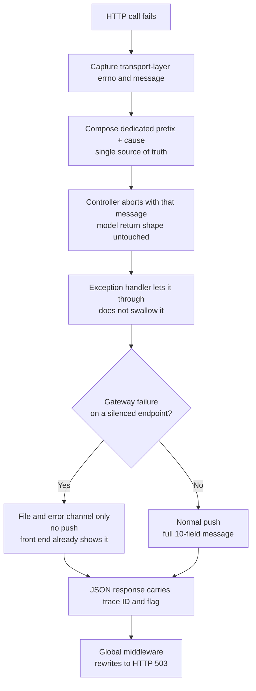

## Background

Back-office exceptions were already pushed to a team chat channel, and someone read that channel daily. The problem was not that nobody knew about errors — it was that the message contained **only a stack trace**. No indication of **who** ran it, **which report** they opened, or **what parameters** they passed. Production writes close to **60,000 log lines a day**; the dozens of lines belonging to one request were scattered among them with no way to stitch them back together.

The other half of the request came from the test environment: the upstream game-administration gateway restarts routinely, and nobody is told. Risk-control staff operating reports simply saw the screen break, so every restart turned into a manual sync — customer service asking engineering "is it broken again?"

The stakeholder's own framing had two halves: **"reduce the maintenance burden on back-office engineers"** and **"just show it in the UI message."**

Only the first half was built, and that was deliberate.

## Five stages

| Stage | What happened | Outcome |
|---|---|---|
| 1 Declined | Surveyed the real blast radius, judged high effort / low impact | ❌ Site-wide rework deliberately declined |
| 2 Partially reversed | Hands-on evidence overturned part of the premise | ⚡ Low-cost items revived; large rework stayed declined |
| 3 Message chain | Three small changes stitched into one semantic chain | ✅ Full chain shipped to test |
| 4 Released | Four staged production deployments, each verified | ✅ Engineer-facing goal 100% met |
| 5 Still not enabled | Operator-facing switches permanently off | ❌ Loops back to the stage-1 judgment |

## Stage 1: deciding not to build it

The original plan was a global front-end interceptor: whenever the backend returned 5xx, the whole site would surface "server restarting, please retry" with no call-site changes. After surveying it, the work was judged high effort / low impact and **deliberately declined**.

### Cost that was avoided

| Item | Original site-wide rework | What was actually used |
|---|---|---|
| HTTP call sites to modify | **98** | 0 |
| Error checks to modify | **39** | 0 |
| Settings pages to re-verify | **10** | 0 |
| Manual acceptance tasks | **93** | 0 |
| New code | across 6+ files, multiple repos | **8-line guard** |
| Core goal achieved | 100% | **100%** |

Both options hit the core goal equally — which is exactly what made the large one low impact: **93 extra acceptance tasks bought the same result**.

### Four hands-on findings that overturned the plan

1. **The interceptor only covered write paths.** The most common action is opening a page (reading settings), and a failed read returned a **non-empty but incomplete** structure with **HTTP 200** — no 5xx to intercept. The user saw a JSON parse error, no less confusing than before.
2. **Each report still needed special-casing.** Once the status code was fixed, the async call helper returned `undefined` on failure (no return inside its catch), so the call site threw a `TypeError` reading a property.
3. **Timeouts could not be added wholesale on the backend.** Write-type requests returned `null` on failure, and **39** checks fell through to "success" because PHP evaluates `null == 0` as `true` — writing a false success into the audit log. Adding a timeout would swap "hangs" for "**audit reports success that never happened**", a strict regression.
4. **The manual acceptance surface was too large.** Among the 93 tasks were items like "bulk reward dispatch must not be interrupted" and "verify 41 null checks individually" — semantics only a human can judge.

The survey also established that **production did not need this feature**: exceptions there were already pushed and read daily. Production was not short of "knowing something failed"; it was short of **context**. Showing a UI notice there would only add reports nobody could act on — the opposite of reducing maintenance burden.

That judgment became the seed of the whole project: it produced the request-trace ID in stage 2, and the final "do not build the operator side" decision in stage 5.

### The alternative

The failure check went into the template that generates new reports, as a standard inclusion:

```php
if ($errorCode !== 0 || $result === false) {
    return ['status' => 1, 'ret' => [], 'error' => 'upstream gateway unreachable: ' . $errorMsg, 'raw' => null];
}
```

Telling the operator **which host and why** is more useful than a generic "server restarting". It travels as HTTP 200 plus a status field, compatible with the 444 existing status checks, at zero migration cost.

## Stage 2: evidence arrives, partial reversal

Four days after declining, real use in the test environment overturned part of the premise. The global interceptor did fire — on a page entirely unrelated to the original assessment — but the same screen also produced an error reading a property of `undefined`. A sweep found **66** instances of the same pattern across the site (of 509 async call sites that read a property straight after `await` with no guard).

Re-surveying also exposed an accounting mistake: the original estimate had **charged the cost of the rejected approach to every follow-up item**. The request-trace ID actually needed 2 new files of roughly 125 lines; the dedicated error channel needed 7 lines.

| Item | Ruling | Reason |
|---|---|---|
| Async call failure now throws | ✅ Revived | One fix covers 66 popups, **zero call-site changes** (423 already had try/catch) |
| Request-trace ID | ✅ Revived | This, not a toast, answers "who ran which report" |
| Dedicated error channel, no cascade on push failure | ✅ Revived | Purely additive, 8 lines |
| Remaining large rework | ❌ Stays declined | New evidence did not move the original reasoning |

### Second reversal: let the audit finish, then change the status code

After the throw shipped, a layer the original assessment had missed entirely surfaced: the **41** controllers using the shared API service returned **HTTP 200 with empty values** when the upstream was down — invisible to both the interceptor (>=500) and the throw (HTTP failure only).

The implementation deliberately avoided calling `abort(503)` directly: each controller writes its audit record **after** the API call, so aborting mid-flight would lose it. Instead the shared service returns a **failure envelope** so the audit still runs, and a global middleware rewrites the status code to 503 afterwards — complete audit, correct HTTP semantics, and consistent front-end behaviour all at once.

> The same guard at three altitudes: into the **generator template** so new code carries it (8 lines per page) → into the **shared service** so everything using it benefits (one change, 41 controllers) → into **middleware** to unify the semantics. Once call sites share a consistent checking style, a guard should graduate from template to built-in.

## Stage 3: the message chain

After the three smaller changes shipped, feedback kept pointing the same way: knowing *which endpoint* failed was not enough — **"upstream gateway unreachable" deserved its own treatment**, recognisable at a glance.



**Why it needed its own semantics**: a generic `TypeError` reads as a bug, not as an upstream restart. "upstream gateway unreachable: Connection refused" is what actually saves the conversation.

## Stage 4: four staged releases, each verified

The constraints were **solo operations and no dedicated QA**. Waiting two weeks before deploying was considered and rejected: **passive waiting does not reduce risk** — two unobserved weeks catch problems no better than two unobserved hours. The approach became an **active observation window**: deploy in the morning, watch logs and alerts that day, never deploy on a Friday (nobody watching over the weekend), and leave a gap between batches so problems stay attributable.

### Post-release state

| Item | Figure |
|---|---|
| Staged deployments | **4 batches** over 6 working days, each verified |
| Alert message fields | 0 context fields → **10** (trace ID / endpoint / operator account / display name / English name / permission group / page / params / stack / gateway flag) |
| Mount-point proof | **656 log lines within 3 minutes** of deployment carried a trace ID |
| Production log volume | **59,726** lines/day; one scheduled job run alone accounts for **508** (indistinguishable before trace IDs) |
| Operator directory backfill | **42** records |

### The decisive proof: the only window that can trigger it

The upstream gateway has one fixed maintenance window per week — the **only** time this project's "connection failure" behaviour can be triggered for real. Cross-referencing audit records with logs reconstructed it:

```log
09:00:13  shutdown countdown broadcast received
09:01:02  all connections dropped
09:19:48  a planner runs one report operation
09:19:51  → ERROR: The Response content must be a string ... "boolean" given
```

Two things were proven at once:

1. **The original symptom reproduced in production** — that error is exactly the "reads as a bug" case the project started from.
2. **The value held end to end** — the same error's log carried the operator's **display name and permission group**. From a bare internal account ID to "a planner / game-planning group", with the full causal chain inside three seconds.

### Verifying without waiting for the window

One batch's core mechanism was not sampled during that window. Waiting another week was unnecessary: the shared API service reads its target address via `env()` rather than `config()`, and Laravel's Dotenv **does not overwrite variables that already exist**. **Turning that pitfall around**: calling `putenv()` before bootstrap, pointing at an address guaranteed to refuse connections, confines the failure to one CLI process and leaves live traffic untouched.

```log
error       = upstream gateway unreachable: couldn't connect to host
empty($res) = false          ← this batch's entire value sits in that one boolean
=> result   = FAIL
```

The audit method opens with `if (empty($res)) return;` — before this batch, a `null` on failure meant roughly **40** controllers wrote **no audit record at all**; afterwards the failure envelope records the failure and its real cause.

> When you need to verify "what happens when the upstream is down" and the upstream is not yours to control, check whether the target address comes from `env()` or `config()`. If it is the former, `putenv()` plus Dotenv's non-overwrite behaviour gives you a fault-injection point that **affects only your process, never live traffic**.

## Stage 5: the operator side stays off

Both switches — the site-wide error toast and the throw-on-async-failure — are **permanently disabled in production**.

**The deciding evidence**: production has had **no unplanned outage in nearly two years**. The upstream gateway is unavailable only during its known maintenance window, so an operator-facing notice has almost no scenario in which to fire. Changing the behaviour of 423 call sites for a situation that has not occurred in two years does not pay for itself. The original "stop manually syncing with customer service about restarts" was satisfied instead by a shared understanding of the fixed maintenance window.

| Side | Status |
|---|---|
| Engineer-facing (reduce maintenance burden) | ✅ **100% met** |
| Operator-facing (show it in the UI) | ❌ **Deliberately not built** |

This applies to production only. Upstream restarts are routine in the test environment, where the notice stays enabled.

This loops straight back to the stage-1 judgment: production was said not to need the feature because its errors were already read and only context was missing. A month later, two years of outage data confirmed the same thing. A feature can be built, verified, and shipped, and it is still legitimate to decide not to enable it — the test is not "we already built it" but how often the situation it addresses actually occurs in that environment.

## Pre-existing defects uncovered during the survey

**A failed read returned an incomplete structure, producing silently wrong numbers.** One settings page displayed **0** for default totals, inflating every field derived by subtraction — with **HTTP 200, no error code, and no log entry**. The cause: a child key was written unconditionally *outside* the guard, so PHP auto-created the parent array, and a failed read returned a **non-empty** array containing only that key, which downstream `!empty()` happily accepted.

**A false safety assurance while simulating the fault.** Changing the environment setting to point at a dead address still sent all three "save" actions to the real upstream. The most misleading part: the config file was correct, the port genuinely refused connections, the interactive console showed the new value, and there was no config cache — **four green signals, wrong conclusion**. The cause is that the dev server is a single long-lived process plus Dotenv's non-overwrite behaviour. Fault simulations now follow a fixed order: change → restart → **verify it is genuinely broken yourself** → only then ask someone to operate it. (That same pitfall was later turned around into a safe fault-injection technique.)

**"It hangs for 300 seconds" was imprecise.** Measured against a blackhole address, connect timeout set and unset both came back at **21.4 seconds** — the OS gives up on TCP retries first. What is genuinely unbounded is "connection established but the server never responds", so the value comes from the total timeout rather than the connect timeout.

## Key trade-offs

| Trade-off | Choice | Reason |
|---|---|---|
| Site-wide interceptor vs template-built-in guard | **Template** | 98 call sites / 93 acceptance tasks bought the same result |
| `abort(503)` vs failure envelope + middleware | **Envelope** | Aborting loses the audit record; the envelope lets it finish |
| Single release vs four batches | **Four** | Solo operations with no dedicated QA; gaps keep failures attributable |
| Two-week soak vs active observation window | **Active** | Two unobserved weeks catch no more than two unobserved hours |
| Ship then enable vs ship then decline | **Decline** | Two years of zero occurrences does not justify touching 423 call sites |
