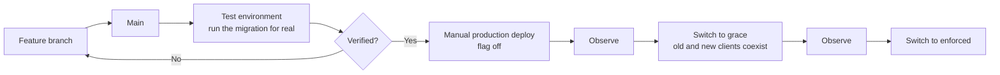

## Background

The change touched **login** — the one entrance nobody in the company can route around. Five departments use it (administration, customer service, finance, planning, operations) across 26 internal accounts.

And this project had **no usable staging environment**. At the time the test and production environments were two different things entirely (that was a separate project's problem), so "verify it in staging first" simply did not exist as an option.

That shaped the whole approach: **if the verification layer cannot be trusted, put the effort into the degradation layer instead**. The feature itself turned out to be the easy part.

## The real deliverable was not the feature — it was five fallback layers

| Layer | Mechanism | What it catches | Type |
|---|---|---|---|
| **L0** | The new check requires two conditions, so the failure mode is **allow**, not deny | Older clients sending nothing / migration not finished / an account missed by the backfill | Automatic — **the only layer that still works when nobody notices** |
| **L1** | Three-state flag (`off` / `grace` / `enforced`) driven by environment config | Feature misbehaves → back to `off` in 30 seconds, no rollback needed | Manual; measured **2 seconds** back to healthy |
| **L2** | Break-glass CLI command that bypasses all application logic | An account locked out, including the sole super-admin | Manual, case by case |
| **L3** | Migration split in two + conditional update | Safe to re-run; never overwrites a value the user already changed | Preventive |
| **L4** | Flag ships **defaulted off** | The timing window created by deployment order | Preventive |
| **L5** | New column `nullable`, and stays nullable even when the rule tightens | Rollback leaves the column in place while old code runs | Preventive |

**L3–L5 are preventive — decided while the code is being written, and impossible to add afterwards.** That distinction matters more than the five layers themselves: L1 and L2 require somebody to notice first, and the genuinely dangerous failures are the ones nobody notices. Hence the design rule behind L0: **the failure mode must be allow**.

## A few decisions and why

| Aspect | Decision | Reason |
|---|---|---|
| Switch | Two environment flags composing three states | Config edit plus reload moves forward *and* back — the **same action** |
| Migration | Schema in one, backfill in another, **never merged** | Merged, a failed backfill leaves the column created but unrecorded in the migrations table; re-running then hits a duplicate-column error |
| Column type | `nullable`, unchanged even when the rule tightens later | After a rollback the column remains while old code runs; NOT NULL would break account creation entirely |
| Validation order | The new check must run **before any side effect** | Misplaced, it means external effects happen before validation passes |
| Error messages | The two failure kinds reported separately, one key at a time | The framework's summariser concatenates multiple messages into a mixed-language string |
| Front-end required field | **Deliberately not enforced** | Hard-coding it means the front end still blocks people when the flag is off — L1 would only half-work |
| Token revocation | Extracted into its own service that also runs the full agent sign-off | Revoking tokens without clearing state leaves a **ghost online** account still receiving assignments |
| Break-glass command | Writes via the query builder, **deliberately not the ORM** | The existing account-creation command fails for exactly this reason — writing outside the fillable list |

## Deployment order is itself a risk window

The deploy script brings **new containers up first** (new code begins serving traffic) and **runs migrations after**. For those few dozen seconds, new code is live while the column does not yet exist.

That is why **L4 requires the flag to ship defaulted off** — not caution, but a window that genuinely exists.

**The desktop client shipped in two stages**: first a separately identified development build that **coexists** with the production build on the same machine, so the user could confirm two key screens on real hardware before the production build went out. A desktop app cannot be rolled back as instantly as a web page, so coexistence is the only way to look before switching.

**Cross-session coordination**: someone else was working in the same repos during the same window. Merging to main immediately overwrites the production image tag via CI — so before acting, check whether the undeployed queue contains someone else's work, or you will ship their unverified changes along with yours.

**Rollback deliberately excludes the database**: the rollback script simply re-runs the deployment and **never calls migration rollback**. The column therefore stays — which is precisely why L5 requires `nullable`. The preferred path is always the L1 flag: 30 seconds, no database involvement.

## Pre-existing defects fixed along the way

The survey surfaced three things **unrelated to this request that were already broken**:

| Defect | State |
|---|---|
| Password recovery path | **Zero routes** — all three entrances broken; if the sole super-admin locked themselves out there was no recovery |
| Agent state after disabling an account | Still **online and still receiving assignments**; tokens were revoked but the assignment pool was not cleared |
| Last-login timestamp column | **Never written** (not in the fillable list), yet displayed in the UI regardless |

The second was the dangerous one: a disabled account still looked online to the assignment system, so customer conversations kept being routed to it. Not part of the request — but since the token revocation path was being touched anyway, it was fixed at the root.

## Numbers

| Aspect | Before | After |
|---|---|---|
| Fallbacks if the feature misbehaves | **0 layers** | **5 layers** |
| Password recovery routes | **0** | 1 break-glass CLI (bypasses the application layer) |
| Ways to invalidate an issued token | 1 (and it created ghost-online accounts) | **3**, all including full agent sign-off |
| Cost of flipping the switch | No switch (edit code, redeploy) | Config edit + reload, **measured 2 seconds** back to healthy |
| Backend automated tests | **0** (skeleton only; the factory method was called nowhere in the repo) | **24** feature tests |
| Existing login tokens | — | **All 31 survived** — the change logs nobody out |
| Data backfill | — | **26 records**, matching the prediction exactly |

Change size: **4 repos, ~2,395 lines** (backend 15 files, web front end 6, desktop client 4, infrastructure 4).

## Key trade-offs

| Trade-off | Choice | Reason |
|---|---|---|
| Wait for staging vs compensate with degradation layers | **Degradation layers** | Staging was a separate project's workload; the layers were buildable that week and remain useful after launch |
| One migration vs two | **Two** | A merged failure desynchronises the column from the migration record, and re-running errors immediately |
| Roll back the database vs code only | **Code only** | Database rollback is riskier in production; leaving the column plus `nullable` is safer |
| Enforce in the front end vs backend only | **Backend only** | A hard-coded front-end rule makes the flag meaningless and halves the fallback |
| Enforce on release vs three-state rollout | **Three states** | `grace` lets old and new clients coexist; a desktop rollout is never instantaneous |

> Without staging there is a ceiling on how certain you can be before release. The only place left to invest is **what happens afterwards** — and that part has to be designed while the code is being written.
