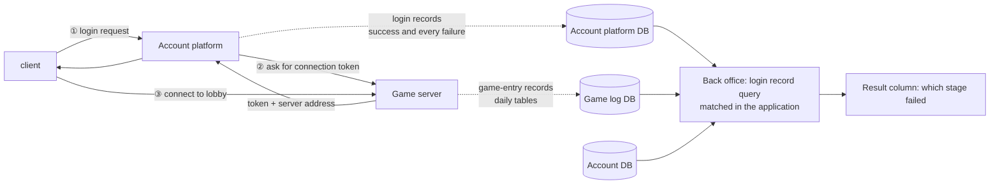

## Background

A login passes through several segments: third-party sign-in, the account platform, the client, the game server, and the game itself. When any one of them fails, everyone sees the same thing: the player cannot get in, or an error message appears.

What started this project was a small event. A colleague in operations saw an error message on the loading screen of a test build, and the PM's first move was to ask the back-office team: "Did the account platform send that?" At that moment the back office had **no tool that could answer**. The error string was not in any back-end codebase, so it could only have come from the client, but proving that took an engineer searching every repository. The PM could not judge it alone, and ended up asking every team in turn.

Looking further, the records on the account platform side were not good enough to begin with:

- The login-record table had "success" and "error code" columns, but in practice **only one kind of failure was ever written** (a failed third-party token check).
- When the game server rejected a login or could not be reached, the account platform **still recorded that login as a success**. The failure existed only in the application's text log.
- Invalid sessions, parameter-validation failures and account-creation failures left no database record at all.
- Logins by recovery code had **never been recorded since launch**. The login method the code wrote was not among the column's allowed enum values, the database ran in strict mode so the write threw, and the exception was swallowed by the logging service's own error handling. Both test and production held zero rows, and nobody had noticed.

## Splitting the problem into ordered stages

Nobody could answer "why can't the player get in" because it is four questions, not one. Once split, each stage maps to one responsible team:

| Stage | What happens | Who to ask when it stops here |
|---|---|---|
| Stage 1: account platform login | The client's login request to the account platform (account, session, third-party token) | Back office (account platform), the third party, or the parameters the client sent |
| Stage 2: obtaining a game connection | The account platform asks the game server for a connection token and server address | The game-server team |
| Stage 3: entering the game | The client connects to the game server with the token and reaches the lobby | Passing stage 2 without stage 3 points to the connection protocol between client and server |
| After entering | Everything past the lobby | In-game features |

Each row on the page is one login, and the result column reads "stopped at account platform login", "stopped at obtaining a game connection", "connection obtained, no game entry seen", or "entered the game". After launch the team set responsibilities by these four results: stage 1 goes to the back office or the client; stage 2 to the server team; reaching stage 3 means the login flow works, and later errors belong to what happens after login.

## Fix the data first, then build the page

For the page to say "stopped at stage 2", stage-2 failures have to be recorded. So the work was split into two changes, and the data change shipped first:

- On the account platform's four login endpoints, **every failure exit writes a failure record**, taking error codes from 1 to 11.
- When the game server rejects or cannot be reached, the **same** login record is updated to a failure, with the server's code, message and request id attached. No second row is added, since that would double the count and force the two rows to be paired up again later.
- The response the client receives is **unchanged, character for character**: on a validation failure the record is written first and the original exception is thrown afterwards; internal fields are stripped before the response is built, and a test compares it field by field.
- Failure records store field names only, never values. Tokens, recovery codes and passwords are not persisted.
- If writing the failure record itself fails, it only logs and the login response is unaffected. One test drops the login-record table entirely and confirms the login API's response stays the same.

Old data is not backfilled: for logins previously recorded as successes, the error message was never stored and cannot be reconstructed.

## Three hosts that cannot be joined

The account platform's login records, the game side's entry records (daily tables, kept for about 90 days) and the account mapping live in three databases on three hosts, across two clouds over the public internet.

| Design | Approach |
|---|---|
| Merging | The three sources are stitched together in the application by account identifier |
| Single-source view | Paginated in the database, so the on-screen count can be checked against the database directly |
| Combined view | Both sides are fetched in full and matched; if either side exceeds 20,000 rows the user must narrow the range, with no silent truncation |
| Maximum range | 90 days, matching the game log's retention; a longer range would show only half the data |
| Latency | Any per-row lookup is amplified to seconds across clouds, so the account mapping the drawer needs is fetched once per page |

Once the view is merged, a wrong number is harder to debug than with two tabs each querying one table. Three things are therefore kept: a **source filter**, a **raw-record drawer** on every row (the original fields from both sides and how they were matched), and **a query statement that can be run as is**. The PM reads the result column; engineers read the drawer.

## The matching rule came from real data

The two sides share no request id, so matching relies on account plus time. The rule was not designed up front:

1. Real data in the test environment came first: for the same login, the two timestamps differ by 0 to 1 second.
2. A case of the client retrying in quick succession turned up: the account platform had records at seconds 28, 31 and 38, the game side at seconds 29 and 39. That reversed the direction from "search forward from the account platform" to "**search backward from the game record for the nearest one**".
3. To tolerate clock drift between hosts, "up to 5 seconds afterwards also counts" was added. A unit test caught the problem at once: the game record at second 29 matched the one at second 31, so a retry stole the match.
4. Final rule: each game record first looks for the latest unmatched success within the 60 seconds **before** it; only if there is none does it take the earliest within the 5 seconds **after**. The two ranges must not be merged into one window.

The matching logic is a pure function that touches no database, covered by 9 unit tests.

## Three problems found in the test environment

**Bots buried the real players.** In the first version on the test environment, one character showed a dozen "game record only" rows in half a day, roughly every 61 minutes, which looked like broken matching. Checking the account type came first: these were load-test bots that connect straight to the game server without going through the account platform, and they made up 97% of that day's game logins (903 of 923). With real players reconciled on their own, the counts on both sides matched for all 8 accounts. The matching was fine; the population contained things that should not have been compared. When two sides disagree, stratify the population before touching the rule.

**The range dropped its last day.** A 90-day query showed 39 "no game entry seen" rows on the first page, all from today and yesterday, yet each had a game record one second later. The cause was in the method that lists daily tables: it steps one day at a time from the start, the start was 3:08 pm, and the last step was still 3:08 pm, later than the end at 3:07:59, so today's table was skipped. The tests missed it because every test started at 00:00. After the fix, 6 unmatched rows remained and all were explainable, and the same query went from 6 seconds to 1.4.

**Rows with an account identifier were labelled "undetermined".** Fixed in the same batch.

All three were fixed at the root before the page went to production.

## Data verification

- The premises were measured before any work began: both environments lacked the recovery-code enum value, both held zero rows for that login method, and both ran in strict mode, confirming that "never recorded" was not a guess.
- Both environments had exactly 93 daily game-log tables, which fixed the retention period at about 90 days.
- To trigger a stage-2 failure in the test environment, the game-server endpoint was briefly pointed at a path that does not exist. The setting was broken for **0.19 seconds** before being restored from a backup and compared.
- In single-source mode, the on-screen count equals the result of running the exported query (657 against 657, 33 against 33).
- With bots removed, the counts on both sides matched for all 8 real accounts, and all 33 logins that day were "entered the game".

## Failure handling

| Case | Handling |
|---|---|
| Account platform database unreachable | The combined view still returns game records and shows a notice above the table that account platform data is temporarily unavailable, instead of presenting it as "no records" |
| Game-log database unreachable | Returns service unavailable. The existing "does this table exist" check answers "no" when the connection fails, so the two cannot be told apart and this page checks the connection separately |
| Merge or export exceeds the limit | Returns an error carrying the current count and the limit |
| Writing a failure record fails | Logged only; login is unaffected |

## Follow-up: making the exchange between two systems visible

Three weeks after launch, two more things did not line up during an investigation. The API column on the page showed only a path, which could not be matched against the spec; and the result code returned by the game server always appeared masked. That field happened to share its name with the SMS verification code, so it was being masked everywhere.

- Masking now applies only to the verification-code position in the **request**; the same-named field in a response is a result code and is shown as is.
- The parameters the account platform sends to the game server, the raw response, the status code and the duration are stored in the login record's additional data. Tokens and signatures are still masked, and a non-JSON response is stored only up to its first 500 characters. Both successes and failures are stored, and none of it appears in the response to the client.
- The API column now maps to the index names in the spec, so searching the spec finds the endpoint.

Before this, a stage-2 problem meant asking the server team to dig through their logs.

## Key trade-offs

| Trade-off | Choice | Reason |
|---|---|---|
| One merged table vs two tabs each on one table | **Merged** | Two tabs assume the user already knows which side the problem is on, which is exactly what they are asking |
| Debugging after the merge | Keep the source filter, raw-record drawer and runnable query | Merging makes numbers harder to trace; a single-source count must be checkable against the database |
| Game-server failure | Update the same record | A second row doubles the count and the funnel would then have to pair two rows |
| Where the merge happens | In the application, capped at 20,000 | The three hosts cannot be joined; "paginate by account platform, then fill in game records" would miss unmatched game records and give a wrong total |
| IP lookup | **Not built** | The IP recorded in production is unusable, and users do not know their own IP anyway |
| Old data | Not backfilled | Error messages that were never stored cannot be recovered |
| Table pagination and headers | Extend the shared component with optional settings | Not hand-built on the page; the 13 existing pages that pass no setting were measured one by one and behave the same |

## Numbers

| Item | Before | After |
|---|---|---|
| "Which team owns this login error?" | Open a ticket, describe the steps, an engineer reads logs on three hosts | Open one page; the result column says which stage failed |
| Recorded login failures | 1 type | 11 types, covering every failure exit on four endpoints |
| Game server rejects or is unreachable | Recorded as a success | Recorded as a failure with code, message and request id |
| Recovery-code login records | 0 rows | Written normally |
| 90-day query (test environment) | 6 s | 1.4 s |
| Automated tests | — | 13 feature tests on the account platform; 15 API tests + 9 unit tests on the query page |

> For a cross-system "why did it fail", split it into ordered stages first, give each stage one responsible team, then make sure every stage leaves a record that can be looked up. The page only draws the stages; the real work is making those records exist.
