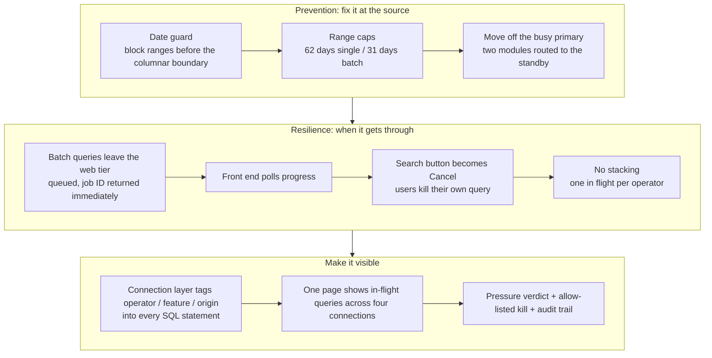

## Background

Risk-control staff had a habit: stretch a cash-flow report to a very long date range, hit search, and walk away.

That habit scanned the production log database until the connection was dropped (about 15 minutes), and **starved every other report** for the duration. Worse, nobody could do anything about it while it happened — engineers had no way to tell who was running what, and the application account had no privilege to cancel a query.

On 2026-09-16 an execution-plan analysis in production isolated the single heavy path: deposit and passbook queries hitting a union of daily shards — roughly **118 tables of 13–19 million rows each, with no index on the player identifier**. One long-range query scans **1.5–2 billion rows**. Every other module already used an index and needed no change.

## Two halves: stop it at the source, and survive what gets through

These are separate pieces of engineering that had to ship together — **prevention alone still lets unknown heavy queries through; resilience alone means somebody has to come to the rescue every single time**.



## The prevention layer

**Date guard**: reject ranges that start before the columnar store's data boundary — data older than that is not in the columnar store, so the query falls back to scanning shards. The boundary lives in environment config rather than in code.

**Range caps**: **62 days** for a single query, **31 days** for a batch. The front end blocks before submitting and the backend blocks again — the front-end check is UX, the backend check is the guarantee.

**Move off the busy primary**: two modules (transfer records and gifting) were repointed at the standby node — a read-only disaster-recovery replica that otherwise sits idle. A two-month single-player query that previously dragged down the primary now measures **23 seconds**.

> This was a real trade-off: the standby exists for disaster recovery, and running reports on it blurs that role. It was adopted anyway — **an idle replica carries far less risk than a starved primary** — and only two read-only modules were moved.

## The resilience layer

**Batch queries leave the web tier**: a batch submission is pushed to a dedicated queue and returns a job ID immediately, with the front end polling for progress. However slow the query gets, it no longer holds a web worker or an HTTP connection.

**Users cancel their own queries**: while a query is running, the Search button becomes Cancel. Pressing it issues `KILL QUERY` against that query — **killing the statement while keeping the connection**, and because it is the account's own query, no elevated privilege is required.

**No stacking**: one query in flight per operator. Already-killed queries do not count, or a user who cancelled would find themselves blocked by their own ghost.

## Making queries visible and attributable

This is what ties the first two layers together: **the connection layer tags operator, feature, and trigger origin into every statement as a SQL comment**.

```sql
/* op=<operator> feat=<feature> via=<origin> */ SELECT ...
```

Tagging is fail-open — if the tag cannot be composed, the query goes out untagged. Tagging must never be a reason a query fails.

Only with those tags can a management page answer "**who is running which report**". Before them, a shared outbound IP made attribution impossible.

## The database task manager

| Aspect | Before | After |
|---|---|---|
| Seeing in-flight queries | Ask a DBA to read the process list | One page, live snapshot across **4 connections** |
| Judging whether the database is busy | Nothing | Status light 🟢🟡🔴 from three global status signals |
| Judging "should this one be killed" | Experience | Pressure verdict (live seconds vs historical p90 + lock waits + efficiency flags) |
| Killing a query | Application account lacked the privilege | Allow-listed kill; scheduled jobs and game-side writes are blocked automatically |
| Accountability afterwards | Shared IP, nobody identifiable | Audit record carrying the operator's display name and a SQL excerpt |

**An allow list, not a block list**: scheduled jobs cannot be killed, game-side and non-back-office writes cannot be killed, and read-only periodic polling is exempt. Deny by default, permit explicitly.

**Degrades without breaking the page**: if the performance schema read privilege is missing, the weight column returns null and the pressure verdict falls back to elapsed seconds from the process list — the page still works.

## The hardest pitfall: wanting to measure "how much is this query using", and not being able to

Two design iterations both tried to produce a "memory share %" column. It never materialised.

The cause was the database version — **per-query memory instrumentation only arrived in MySQL 5.7.2**, and earlier versions physically cannot provide it; the one process-list memory column that looks usable is MariaDB-specific, not MySQL.

The fix was **to change the question**: the percentage column was removed entirely in favour of a **pressure verdict**. On that version, the only live per-query signal available is the statement timer's accumulated wait, so the verdict was rebuilt from "live seconds relative to this query class's historical p90" plus lock waits and efficiency flags, emitting 🔴 kill / 🟡 watch / normal.

> The lesson is not "that version is bad". It is that **when a metric is physically unavailable, the right move is to find a different metric that answers the same decision — not to keep trying to synthesise the original number.** What the user actually wanted was never "what percentage" but "**should I kill this one**".

## Three more pitfalls

**Kill does not stop probe-loop-shaped reports.** Some reports are not running one long statement — they loop, probing whether each shard exists. The thread spends most of its time waiting on the application to compose the next statement, so a kill signal lands on nothing. This is also precisely why the probing had to be batched.

**The queue's default retry window caused duplicate execution.** A report job can run for tens of minutes, while the default redelivery time is far shorter — so a job still running was judged timed out and redispatched, and the same heavy query ran twice concurrently. The retry window must match real job duration, with retries set to 1.

**Documentation lagged the code, producing a false negative in a filter.** A condition written from the documentation matched nothing against real data, silently. Conclusions of the form "there is none" must be cross-checked by a second method before being trusted.

## Numbers

| Metric | Before | After |
|---|---|---|
| Long-range cash-flow query | Scans **1.5–2 billion rows** → connection dropped (~15 min) + starves other reports | Guard and caps keep it in light territory; batches leave the web tier; cancellable live |
| Shard-existence probing | Per-table probe loop, **~52 seconds** | A single system-schema query |
| Killing a heavy query | Impossible (thread waiting on the app; auto-reconnect revived it) | One click, no elevated privilege needed for one's own query |
| Two-month gifting query | Dragged down the busy primary | Routed to the standby, measured **23 seconds** |
| Wide-range machine query | Failed with too many bound parameters | Resolved alongside the probe batching |

## Key trade-offs

| Trade-off | Choice | Reason |
|---|---|---|
| Guard at the source vs rescue afterwards | **Both** | Guarding alone misses unknown heavy queries; rescue alone means someone must respond every time |
| All reports async vs batch only | **Batch only** | Single queries are already fast within the caps; making everything async turns every report into polling — a UX regression |
| Move the whole module to standby vs two | **Two** | The standby's real job is disaster recovery; the more that runs on it, the greater the risk |
| `KILL` vs `KILL QUERY` | **`KILL QUERY`** | Kills the statement but keeps the connection, so the pool is not punctured |
| Memory share % vs pressure verdict | **Pressure verdict** | The former is physically unavailable on that version; the latter answers the same decision |
| Keep the probe-loop fallback | **Keep it** | If the batched query fails on privileges or version, probing must still degrade rather than break the page |
