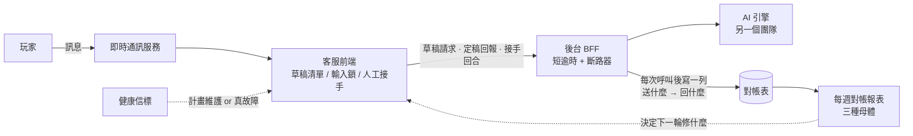

## 背景

線上客服原本全程手打回覆。這個案子要把「AI 先產生草稿、真人審核後送出」織進既有的客服系統:AI 不直接對玩家發話,客服可以原話送出、改寫後送出,或接手改成純人工。

AI 引擎由另一個團隊負責,我負責的是把它接進既有的即時通訊鏈路:客服前端、後台 BFF,以及兩者之間的降級與量測。

這一頁的主軸不是功能清單。功能在上線那天就做完了;之後三個月的工作是**八輪迭代**,而每一輪要修什麼,幾乎都不是靠人回報,是靠一張對帳表自己浮出來的。

## 架構



對 AI 引擎有三種呼叫:**草稿請求**(玩家發話後要一則草稿)、**定稿回報**(客服送出後,回報採用了原話還是改寫了什麼)、**接手回合**(客服接手後的純人工回覆)。定稿回報是引擎的學習來源,後面好幾輪都跟它有關。

## 迭代的前提:上線同一天就埋點

後台 BFF 每次呼叫引擎之後,往對帳表寫一列:哪一通對話、哪一則草稿、哪位客服、引擎回了什麼狀態,以及**送出去的整包內容**與**引擎回的錯誤原文**。寫入不阻斷主流程,失敗只記警告,並有開關可以臨時關掉。

這張表有兩個用途。一是客服團隊每週來對帳、而且持續改規格,我方必須自己拿得出數字,不能只看對方的儀表板。二是**沉默的失效不會自己來敲門**:呼叫照樣回應、畫面照樣運作、沒有任何人會回報,只有把成功與失敗按條件分組,異常才看得見。

## 八輪迭代

| 輪 | 發現了什麼 | 怎麼發現的 | 改了什麼 |
|---|---|---|---|
| 1 | 客服改寫草稿的定稿回報 **100% 被引擎拒收** | 把回應狀態依「原話送出／改寫送出」分組,零例外的乾淨分界 | 補上改寫原因的標註通道 |
| 2 | 136 通對話裡 **127 通(93%)進過人工接手** | 對帳報表的「送出組成」拆解 | 套用話術改成算一種修正,沒有草稿就不進接手 |
| 3 | 規格說「引擎已支援」不等於真的部署了 | 自建契約驗證指令,拿規格範例直接打引擎 | 引擎部署後重驗,12/12 通過 |
| 4 | 規格把改寫原因從五大類十七細項換成六類 | 新舊規格逐節比對 | 送出格式跟著改 |
| 5 | 接手中「看了草稿決定不用」的評價整批沒被記到 | 從資料反推:894 筆接手回合裡 **350 筆手上其實有草稿** | 有草稿就走定稿回報,沒有才走接手回合 |
| 6 | 一個玩家洗版就能把客服的瀏覽器灌爆 | 客服回報後查對帳表:107 次呼叫全數成功,問題在前端 | 草稿清單封頂 + 同一通對話降頻 |
| 7 | 第 6 輪的降頻,在洗版尾段留了一個洞 | 引擎團隊提出質疑後,逐則比對時間戳 | 批次結束時保留已排程的呼叫 |
| 8 | 開啟對話時只把最後一則送進 AI | 引擎團隊提供的逐則時間戳 | 改成補送上次客服回覆之後的整批未讀 |

前五輪沒有一項來自客服回報或人工巡檢。後三輪由外部先提出,但定位問題靠的仍是同一張表。

### 第 1 輪:客服的每一次修正,從來沒有送達

上線三天後把定稿回報按「客服是否改寫」分組:原話送出的 17 筆全部成功,改寫送出的 29 筆**全部失敗**。

原因是引擎的契約要求:回報為改寫時,必須附上改寫原因的標註,而我方從沒送過這個欄位。因為定稿回報是盡力而為、失敗不影響客服送出訊息,所以從上線起,客服每一次改寫 AI 草稿的修正都沒有進到引擎,學習迴路在這條路徑上一次都沒轉過。

對帳表存的是引擎回的錯誤原文,所以不用猜也不用問,拿原文就能定位。

### 第 2 輪:93% 的對話都「人工接手」了

送出組成拆開後,接手回合有 643 筆,定稿回報只有 46 筆。136 通對話裡 127 通進過接手,看起來像是 AI 幾乎沒被用到。

根因是舊設計:客服選了一句話術,系統就當成「接手改人工」。客服團隊定調「套話術也是一種對草稿的修正」之後,改成綁在定稿回報上。這個 93% 如果沒有被量出來,不會有人覺得它是問題。

對帳報表刻意做了三種母體:全部客服回覆、送出組成、扣掉引擎自己判定需要人工之後的可服務則數。同一份資料換分母可以講出相反的結論,所以對數字之前先對齊分母。

### 第 5 輪:分母變誠實,指標反而下降

接手之後,客服手上常常還留著一則草稿,只是決定不用它。這類回覆走的是接手回合,不帶草稿編號,所以「客服拒絕了這則草稿」的評價整批沒被記到。從資料反推,894 筆接手回合裡有 350 筆屬於這種情況。

修正後評估指標的涵蓋率從 56% 升到接近 100%。副作用是 AI 的採用率會下降,因為這 350 筆全是被拒絕的案例,原本被系統性地排除在分母之外。這件事在對帳前就先跟看報表的人講清楚,否則會被讀成 AI 退步。

### 第 6 輪:合併機制完全沒作用,而第一版防護自己會震盪

客服回報「AI 又壞了,重新登入就好」。先查對帳表:那段時間 107 次呼叫全數成功,後端零錯誤。引擎與後台都正常,問題在瀏覽器端;草稿清單只存在記憶體,這也解釋了重新登入為什麼有效。

實際發生的事:一位玩家在 14 分鐘內發了 113 則、每 7 秒一則,同一通對話堆了上百則草稿。

有兩點與直覺相反:

- **去抖動擋不住。** 合併條件是「距上一則 3 秒內」,而對方每 7 秒一則,每一則都自成一批。窗口必須比對方的節奏長,合併才會發生。
- **合併減少的是草稿則數,不是呼叫次數。** 每收到一則就用合併後的內容重打一次,所以就算合併成功,呼叫數也不會降。

修法是兩道:草稿清單封頂 10 則(正在合併的與已套用的不丟),以及同一通對話在 60 秒內發話超過 6 則時,把呼叫的最短間隔拉到 15 秒。只限制這一通,正常對話不受影響。

第一版降頻拿**自己的呼叫次數**當洗版的偵測訊號,結果是:

```log
降頻生效 → 窗口內呼叫數掉到門檻以下 → 自動解除降頻 → 又全速呼叫 → 再次觸發
```

控制動作把自己的偵測訊號消滅了。模擬只從 107 次降到 83 次,才發現不對。改成量**玩家的發話頻率**(不會因為我降頻而改變)之後,穩定在 56 次。

這類行為正常操作測不出來,所以寫了一支模擬器,直接載入上線的那份程式碼(不是複製一份出來測),配虛擬時鐘灌入同樣的節奏。

### 第 7 輪:三週後,洞是我自己的防護挖的

又一次洗版,這次是另一位玩家,48 秒 34 則。引擎團隊先來問:某個時間點之後兩分多鐘,後台完全沒有呼叫,是什麼擋掉的?

逐則比對時間戳之後,結論是一半一半:

| 對方的質疑 | 查證結果 |
|---|---|
| 兩分多鐘沒有呼叫 | **不成立。** 玩家自己在那個時間點就停手了 |
| 後台擋掉了呼叫 | **部分成立。** 停手前的最後 7 則確實沒有產生草稿 |

根因在我第 6 輪加的降頻:最後 7 則排了一次 15 秒後的呼叫,但玩家停手 3 秒後,「批次結束」的清理程序把還沒到期的排程一併取消了。降頻與批次清理各自都對,洞在兩者的交界。

第一個修法是「批次結束就立刻補打」。拿第 6 輪的節奏跑回歸,呼叫數彈回 113 次,等於把降頻整個廢掉。正解是讓排程照原定時間走完,不提早也不取消。

第一版模擬器看不見這個洞,因為它只載入了我認為相關的兩個函式,從頭到尾沒有跑過批次結束那一段,而問題就在那一段裡。第二版把整個批次的生命週期接起來之後才測得出來。兩次都是同一種錯:模擬到的範圍比真實系統小。

### 第 8 輪:名字叫錯,會讓所有人找錯地方

引擎團隊回報「AI 讀不到玩家的第一句」,並描述成「玩家連傳好幾則」。但他附的實例間隔是 5 秒與 7 秒,都超過合併窗口,本來就不會是同一批。

真正的條件是:對話沒有開著的時候,玩家累積了幾則未讀,而開啟對話的那一刻只把最後一則送進 AI。這與間隔無關,隔十分鐘一樣會漏。

叫它「連傳」會把人推去查洗版防護,而那裡沒有問題。改名為「未讀補送」之後,驗收方式也跟著改對了:要測的是「慢慢傳、先不要開對話」,不是快速連發。

## 草稿什麼時候產生:三個情境、三套機制

這三件事很容易被當成同一件,我和引擎團隊各踩過一次。

| 情境 | 機制 | 參數 | 看訊息間隔 |
|---|---|---|---|
| 對話開著,正常發話 | 去抖動合併:玩家靜默後把整串當一則 | 靜默 3 秒收批、最長等 10 秒 | 是 |
| 對話開著,玩家洗版 | 同一條路徑加兩道保護:降頻、草稿封頂 | 60 秒內超過 6 則 → 最短間隔 15 秒;清單上限 10 則 | 是 |
| 對話沒開,未讀累積 | 未讀補送:開啟對話時補送未回覆的整批 | 往前取到上次客服回覆,有則數與字數上限 | 否 |

## 迭代前後

| 指標 | 修正前(啟用後第一週) | 修正後(次週) |
|---|---|---|
| 定稿回報失敗率 | **62.5%**(55/88) | **8.6%**(109/1,268) |
| 定稿回報總筆數 | 88 | **1,268** |
| AI 原話送出 | 33 | **326** |
| 評估指標涵蓋率 | 56%(449/799) | 接近 **100%** |

仍然量不到的部分:接手之後的第二、第三則回覆沒有草稿可以比對,佔接手回合的六成,引擎學不到。客服團隊知情並接受,因為硬記進指標只會製造假的「AI 失敗」。

## 降級設計

AI 引擎的回應時間不穩定,維護時也沒有任何提示。新機制壞掉時,原本的客服流程必須照樣走得通。

| 情況 | 處理 |
|---|---|
| 引擎回應慢 | 草稿請求用 9 秒短逾時,失敗累積達門檻就開路(斷路器),前端不被拖住 |
| 引擎維護 | 一收到「伺服器無回應」就立刻解鎖手動輸入,不等斷路器門檻 |
| 分不出維護還是故障 | 另問健康信標,錯誤提示寫具體觀察到的事實(信標可連線、維護旗標為否、但草稿請求失敗),不寫「服務異常請通報工程師」 |
| 新增的接手綁定查不到或資料表不存在 | 查詢全部包在例外處理內,查無就讓原本的四層派單邏輯照舊 |
| 引擎回空草稿 | 顯示說明文字、不提供套用;引擎的原因碼用前綴比對,認不得的新值落到通用提示 |

最後一項之前出過實證:正式環境是程式先上、資料表後建,中間有一段資料表還不存在的空窗,在線客服沒有任何異常回饋。不過這個空窗本來就不該存在,正確順序是資料表先建;降級接住了它,不代表流程沒問題。

## 啟用前先凍結基線

AI 一開,「純人工客服長什麼樣」就再也量不到了。所以啟用前把 12 個月、295,365 則的歷史對話跑成一條可重跑的分析管線,並把連客服團隊自己都定義不出來的「該轉真人卻沒轉」,收斂成可操作的代理指標:回覆前沒有辱罵、回覆後才出現的比例,人工時期基線 5.4%。

基線直接影響了一個設計判斷。客服回覆裡有 22% 到 26% 需要查後台資料或人工判斷才寫得出來。引擎團隊設定的全自動門檻是採用率 0.95,而照這個比例推算,AI 不接後台查詢工具時採用率上限約 94%,接了才到約 97.9%。也就是說,接工具不是效率問題,而是那條門檻能不能達到的前提。

## 關鍵取捨

| 取捨 | 選擇 | 理由 |
|---|---|---|
| 降頻的偵測訊號 | 玩家的發話頻率 | 自己的呼叫次數會被降頻本身改變,控制會震盪 |
| 壓制洗版的手段 | 只對該通對話降頻 | 把全域的合併窗口拉長也有效,但等於為了一個人對所有對話加延遲 |
| 接手後的派單黏著 | 在派單邏輯最前面加一層綁定,查無就照舊 | 另一個選項是改掉全域派單熱路徑的一個條件,一行就解決,但所有玩家訊息都經過那裡 |
| 客服在線狀態 | 唯讀的三態燈號 | 心跳續命綁單一工作階段,與客服習慣開兩個瀏覽器衝突 |
| 定稿回報失敗 | 不阻斷客服送出 | 客服回覆玩家是主流程;代價是失敗是沉默的,所以才需要對帳表 |
| 對帳報表的母體 | 三種並列 | 對數字的爭議幾乎都在分母,單一母體會被質疑挑選 |

> 這個功能的測試環境只有一兩位客服在線,分派、併發、洗版這類問題在那裡不會出現。既然上線前驗不完,能做的是兩件事:讓新機制壞掉時退回原本的行為,以及讓壞掉的那一刻留下看得見的紀錄。
