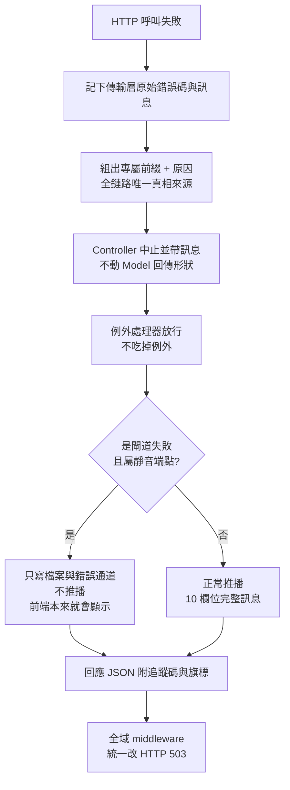

## 背景

後台的錯誤早就會推到團隊的即時通訊頻道，而且每天有人看。問題不在「沒人知道出錯」，在於**訊息裡只有一段 stack trace**——不知道是**誰**、查了**哪一份報表**、帶了**什麼參數**。正式環境單日日誌近 **6 萬行**，同一次請求的數十行散落其中，無法串回。

另一半的需求來自測試環境：上游的遊戲端管理閘道重開是常態，且不會同步給各部門。風管在操作報表時只看到畫面爆掉，於是每次重開都要人工同步——客服來問工程師「是不是又壞了」。

需求方原話界定的目標有兩半：**「減輕後台工程師的維護負擔」**，以及**「直接顯示在提示裡」**。

最後只做了前半，而且是刻意的。

## 全案五個階段

| 階段 | 做了什麼 | 結果 |
|---|---|---|
| 1 棄做 | 盤點真實改造面，判定 high effort / low impact | ❌ 主動棄做全站改造 |
| 2 翻案 | 測試環境實證推翻部分前提 | ⚡ 低成本項復活，大改造維持棄做 |
| 3 訊息鏈 | 三個小案縫成一條語意鏈 | ✅ 全鏈路上測試環境 |
| 4 上線 | 四批分批部署、逐批實證 | ✅ 工程師端 100% 達成 |
| 5 仍然不做 | 操作者端開關最終永久關閉 | ❌ 回扣第一階段的判斷 |

## 第一階段：先判定不做

原定方案是加一顆全域前端攔截器，讓後端回 5xx 時全站自動顯示「伺服器重開中」，不需修改任何呼叫端。盤點後判定 high effort / low impact，**主動棄做**。

### 被省下的成本

| 項目 | 原定全站改造 | 實際採用 |
|---|---|---|
| 要修改的 HTTP 呼叫端 | **98** 個 | 0 |
| 要修改的錯誤判斷 | **39** 處 | 0 |
| 要逐支驗證的設定頁 | **10** 支 | 0 |
| 人工驗收項目 | **93** 個 | 0 |
| 新增程式碼 | 跨 6+ 檔、跨 repo | **8 行守衛** |
| 核心目標達成度 | 100% | **100%** |

兩者的核心目標達成度相同——這正是判定 low impact 的依據：**多花 93 個驗收項目換到的是同一個結果**。

### 四項推翻原方案的實測

1. **攔截器只覆蓋「寫入」路徑**。最常做的是開頁面（讀設定），而讀取失敗時回的是「非空但殘缺」的結構加 **HTTP 200**，沒有 5xx 可攔。使用者看到的是 JSON 解析錯誤，跟原本的困惑無異。
2. **每支報表仍要寫特規**。修好回應碼後，非同步呼叫工具失敗回 `undefined`（catch 內沒 return），呼叫端讀屬性直接拋 `TypeError`。
3. **後端無法整批加逾時**。寫入類請求失敗回 `null`，**39 處**判斷因 PHP 的 `null == 0` 為 `true` 而落入「成功」並寫進稽核紀錄。加逾時等於把「掛住」換成「**稽核謊報成功**」，是嚴格的退步。
4. **人工驗收面過大**。93 個任務中含「批量發包不能被打斷」「41 處 null 判斷逐處驗」等只能人工判斷語義的項目。

同時發現**正式環境其實不需要這個功能**：那裡的例外早就會推播、且每天有人看。正式環境缺的不是「知道出錯」，是**上下文**。在那裡顯示提示只會增加無法處理的回報量——與「減輕維護負擔」的目標相反。

這個判斷成為全案的種子：它在第二階段導出請求追蹤碼，也在第五階段導出「操作者端不做」的最終決定。

### 替代方案

把失敗判斷寫進新報表的產生範本，成為標配：

```php
if ($errorCode !== 0 || $result === false) {
    return ['status' => 1, 'ret' => [], 'error' => '上游閘道連線失敗: ' . $errorMsg, 'raw' => null];
}
```

直接告訴操作者**哪一台、什麼原因**，比通用的「伺服器重開中」更有用；走 HTTP 200 加狀態欄，與既有 444 處狀態碼判斷相容，零改造成本。

## 第二階段：證據出現，部分翻案

棄做四天後，測試環境的實際操作推翻了部分前提：全域攔截在一個與原評估完全無關的頁面上確實生效，但同畫面出現讀取 `undefined` 屬性的錯誤——實測全站 **66 處**同樣 pattern（509 個非同步呼叫點中 await 後直接讀屬性且無守衛）。

重新盤點也發現：原棄做評估把「不採用方案的成本」**誤記成所有後續項的成本**。實際上請求追蹤碼只需 2 個新檔約 125 行，獨立錯誤通道只需 7 行。

| 項目 | 裁定 | 理由 |
|---|---|---|
| 非同步呼叫失敗改 throw | ✅ 復活 | 1 處修 66 處彈窗、**零呼叫端改動**（423 處本來就有 try/catch） |
| 請求追蹤碼 | ✅ 復活 | 它才是「誰查了什麼報表」的正解 |
| 獨立錯誤通道 + 推播失敗不連鎖 | ✅ 復活 | 純加法 8 行 |
| 其餘大改造項 | ❌ 維持不做 | 原理由未被新證據動搖 |

### 翻案第二輪：先讓稽核跑完，再改狀態碼

throw 上線後又抓出一個原評估完全漏掉的層：走共用 API 服務的 **41 個** controller，在上游關機時「**回 200 + 空值**」——攔截器（>=500）與 throw（HTTP 失敗才觸發）**都攔不到**。

落地時刻意**不直接 `abort(503)`**：controller 的稽核紀錄寫在 API 呼叫**之後**，中途中止會漏記。改成**先讓共用服務回一個失敗信封讓稽核跑完，再由全域 middleware 把狀態碼改成 503**——稽核完整、HTTP 語意正確、前端觸發一致，三者兼得。

> 同一個守衛的三種落點：寫進**產生範本**讓新程式帶著（8 行/頁）→ 寫進**共用服務**讓走該服務的都有（一處改、41 個 controller 受益）→ 寫進 **middleware** 統一語意。發現呼叫端判斷風格一致時，守衛就該從範本升級為內建。

## 第三階段：訊息鏈長成

三個小案上線後持續收到回饋，都指向同一個方向：光有「哪個端點出錯」還不夠，**「上游閘道連線失敗」該有自己的專屬待遇**，工程師看一眼就該秒懂。



**為何要專屬語意**：泛用的 TypeError 訊息，工程師看到只會覺得有 bug，不一定會聯想到上游重開；而「上游閘道連線失敗: Connection refused」才真正省下溝通成本。

## 第四階段：四批上線與實證

條件是**單人維運、沒有專職驗收人力**。原本考慮「等兩週再部署」，但判斷**被動等待不會降低風險**——沒人盯的兩週跟沒人盯的兩小時，抓到問題的機率一樣。改為**主動觀察窗**：早上部署、當天盯日誌與通知、絕不在週五部署（週末無人觀察）、批次間留緩衝避免問題疊加難歸因。

### 上線後的實際狀態

| 項目 | 數字 |
|---|---|
| 分批部署 | **4 批**，6 個工作天，逐批實證 |
| 通知訊息欄位 | 0 個上下文 → **10 個**（追蹤碼／端點／操作者帳號／中文名／英文名／權限組／頁面／參數／堆疊／閘道旗標） |
| 掛載實證 | 部署後 **3 分鐘內 656 行**日誌帶追蹤碼 |
| 正式環境日誌規模 | 單日 **59,726** 行；單一排程一次執行佔 **508** 行（有追蹤碼之前無法辨識） |
| 操作者名冊回填 | **42** 筆 |

### 決定性實證：唯一能觸發的時間窗

上游閘道每週有一次固定維護窗——這是本案「連線失敗」行為**唯一**能被真實觸發的時間。用稽核紀錄與日誌交叉還原：

```log
09:00:13  收到關機倒數廣播
09:01:02  所有連線被踢掉
09:19:48  某位企劃執行一次報表操作
09:19:51  → ERROR: The Response content must be a string ... "boolean" given
```

兩件事同時被證明：

1. **最初要解決的症狀在正式環境重現**——那筆錯誤正是專案起點「工程師看到只會覺得有 bug」的那一種。
2. **價值端到端成立**——同一筆錯誤的日誌帶著操作者的**中文姓名與所屬權限組**。從「只有一串內部帳號」到「某位企劃 / 遊戲企劃組」，加上 3 秒內的完整因果鏈。

### 不等窗口也能驗：把失敗侷限在自己的行程

其中一批的核心機制在那次窗口沒被取樣到。但不必等下週——共用 API 服務用 `env()` 而非 `config()` 取目標位址，而 Laravel 的 Dotenv **不覆寫已存在的環境變數**。**把這個坑反過來用**：在 bootstrap 之前 `putenv()` 指向一個必定拒連的位址，連線失敗就只發生在自己的 CLI 行程，線上流量完全不受影響。

```log
error       = 上游閘道連線失敗: couldn't connect to host
empty($res) = false          ← 這一批的全部價值就在這一個布林值
=> result   = FAIL
```

稽核方法第一行是 `if (empty($res)) return;`：這批之前失敗回 `null`，約 **40 個** controller 的稽核**整筆不寫**；之後回失敗信封，寫下失敗與真實原因。

> 要驗「上游掛掉時的行為」而上游不歸你控制時，先看目標位址取自 `env()` 還是 `config()`。若是前者，`putenv()` 加上 Dotenv 不覆寫的特性，就給你一個**只影響自己、不影響線上流量**的故障注入點。

## 第五階段：最終仍不啟用操作者端

全站錯誤提示與非同步失敗 throw 這兩個開關，在正式環境**永久關閉**。

**決定性依據**：正式環境**近兩年沒有發生過非預期斷線**。上游閘道只在已知的維護窗不可用，所以操作者端的 UI 提示幾乎沒有會觸發的場景。為一個兩年沒發生過的情境去改變 423 個呼叫點的行為，投入產出不成立。原本要靠 UI 解決的「不用一直跟客服同步現在是不是在重開」，用「固定維護時間」這個共識就滿足了。

| 面向 | 狀態 |
|---|---|
| 工程師端（減輕維護負擔） | ✅ **100% 達成** |
| 操作者端（直接顯示在提示裡） | ❌ **刻意不做** |

適用邊界是正式環境。測試環境的上游重開是常態，那裡的提示維持啟用。

這正是第一階段判斷的回扣：當時判定「正式環境其實不需要這個功能」，理由是那裡的錯誤本來就有人看、缺的只是上下文。一個月後，用兩年的實際斷線數據證實了同一件事。一個功能做完了、驗證過了、也上線了，仍然可以決定不啟用——判準不是「做都做了」，而是它要解決的情境在這個環境實際發生的頻率。

## 盤點期挖出的既有缺陷

**讀取失敗回傳殘缺結構，導致靜默錯誤數字**。某個設定頁的「預設總押／總得」顯示 **0**，而相減得到的欄位全被灌大，**HTTP 200、無錯誤碼、無日誌**。根因是在條件判斷**之外**無條件寫入一個子鍵，PHP 自動建立了父陣列，失敗時回傳一個只剩該鍵的**非空**陣列，下游的 `!empty()` 因此通過。

**模擬故障時發出了錯誤的安全保證**。為了改目標位址而修改環境設定，結果三次「儲存」全部打到真的上游。誤導最強的是：設定檔內容正確、連接埠確實拒連、互動式查詢顯示新值、無設定快取——**四項全綠**，結論仍是錯的。根因是開發伺服器是單一長駐行程，加上 Dotenv 不覆寫既有環境變數。此後模擬故障類的驗證順序固定為「改 → 重啟 → **自己先驗真的壞了** → 才請人操作」。（這個坑後來被反過來利用成安全的故障注入手段。）

**「300 秒卡住」的說法不精確**。對黑洞位址實測：有設與未設連線逾時**都是 21.4 秒**——作業系統的 TCP 重試先放棄。真正無上限的是「連線建立成功但伺服器不回應」，所以主要價值來自總逾時設定而非連線逾時設定。

## 關鍵取捨

| 取捨 | 選擇 | 理由 |
|---|---|---|
| 全站攔截器 vs 範本內建守衛 | **範本** | 98 呼叫端 / 93 驗收項，換到的是同一個結果 |
| `abort(503)` vs 失敗信封 + middleware | **信封** | 直接中止會讓稽核漏記；信封讓稽核先跑完 |
| 一次上線 vs 四批 | **四批** | 單人維運無專職驗收，批次間留緩衝才歸因得了 |
| 等兩週觀察 vs 主動觀察窗 | **主動** | 沒人盯的兩週，抓到問題的機率跟兩小時一樣 |
| 做完就啟用 vs 評估後不啟用 | **不啟用** | 兩年零發生的情境，不值得改 423 個呼叫點 |
