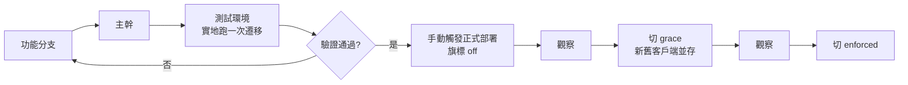

## 背景

要改的是**登入**——全公司唯一無法繞過的入口。使用它的是管理、客服、財務、企劃、營運五個部門，共 26 個內部帳號。

而這個專案**沒有任何可用的 staging 環境**。測試環境與正式環境當時是兩套不同的東西（那是另一個專案的題目），所以「在 staging 驗過再上」這條路不存在。

這決定了整個做法：**既然驗證層不可靠，就把力氣全部投到降級層**。功能本身反而是最簡單的部分。

## 這個案子真正的產出不是功能，是五層退路

| 層 | 機制 | 接住什麼 | 型態 |
|---|---|---|---|
| **L0** | 新驗證採雙重條件，失敗模式是**放行**不是拒絕 | 舊客戶端沒送值／遷移未跑完／回填漏掉帳號 | 自動，**唯一在沒人察覺時仍生效的一層** |
| **L1** | 三態旗標（`off` / `grace` / `enforced`），改環境設定即可 | 功能出包 → 30 秒退回 `off`，不需回滾 | 需人動手，實測 **2 秒**恢復健康 |
| **L2** | 破窗 CLI 指令，繞過所有應用層邏輯 | 帳號鎖死（含唯一的超級管理員） | 需人動手，個案 |
| **L3** | 遷移拆成兩支 + 條件式更新 | 重跑安全、不覆蓋使用者已改的值 | 預防型 |
| **L4** | 旗標**預設關閉**上線 | 部署順序造成的時間窗 | 預防型 |
| **L5** | 新欄位 `nullable`，即使收緊也不改 NOT NULL | 回滾後欄位還在但跑舊程式碼 | 預防型 |

**L3～L5 是預防型——在寫程式碼的當下就決定了，事後補不了。** 這個分野比五層本身更值得記住：L1、L2 需要有人發現問題才會啟動，而真正危險的是**沒人察覺的失敗**。所以 L0 的設計準則是「失敗模式必須是放行」。

## 幾個決定與它們的理由

| 面向 | 決策 | 理由 |
|---|---|---|
| 開關 | 兩個環境旗標組成三態 | 改設定檔 + 重載即可前進後退，**同一個動作** |
| 遷移 | schema 一支、資料回填一支，**不可合併** | 合寫時回填失敗 → 欄位已建立但遷移表沒紀錄 → 重跑撞重複欄位錯誤 |
| 欄位型別 | `nullable`，即使之後收緊也不改 | 回滾後欄位還在但跑舊程式碼，NOT NULL 會讓建帳號全掛 |
| 驗證順序 | 新檢查必須在**任何副作用之前** | 放錯位置等於驗證還沒過就已經造成外部影響 |
| 錯誤訊息 | 兩種失敗分開回報，一次只回一個鍵 | 框架的摘要方法對多則錯誤會產生中英混雜的串接字串 |
| 前端必填 | **刻意不做** | 前端寫死必填的話，旗標關掉時前端仍會擋人 → L1 只救得了一半 |
| 權杖撤銷 | 抽成獨立服務，撤銷時一併跑完整的客服下線 | 只撤權杖不清狀態 = **幽靈上線**，帳號停用後仍被派單 |
| 破窗指令 | 只用查詢建構器直寫，**刻意不走 ORM** | 既有的建帳號指令正是死在寫入白名單以外的欄位 |

## 部署順序本身就是一個風險窗

部署腳本的順序是**先起新容器**（新程式碼開始服務流量）**才跑資料庫遷移**。中間那幾十秒，新程式碼已經在跑、但欄位還不存在。

這就是 **L4 旗標必須預設關閉上線**的原因——不是保守，是那個窗口真實存在。

**客戶端分兩階段發版**：先出一個獨立識別的開發版，與正式版**並存**於同一台機器，由使用者實機確認兩個關鍵畫面正常，再推正式版。桌面應用無法像網頁一樣即時回滾，所以並存是唯一能「先看再換」的做法。

**跨 session 協調**：同時段另有一人在同一批 repo 上工作。合併進主幹的當下，持續整合會覆蓋正式映像標籤——所以動手前要先確認「未部署佇列裡有沒有別人的東西」，否則會順手把別人沒驗過的改動一起推上去。

**回滾方式刻意不含資料庫**：回滾腳本只是重跑部署，**從不呼叫遷移回滾**。所以欄位會留著——這正是 L5 要求 `nullable` 的原因。優先的退路永遠是 L1 旗標（30 秒、不動資料庫）。

## 順手補掉的既有缺陷

盤點時發現三件**跟本次需求無關、但已經壞著**的事：

| 缺陷 | 狀況 |
|---|---|
| 忘記密碼的救援路徑 | **0 條**——三個入口全壞，唯一的超級管理員若鎖死就沒救 |
| 停用帳號後的客服狀態 | 殘留在線，**持續被派單**；只撤權杖不清派單池 |
| 最後登入時間欄位 | **從未被寫入**（不在可填寫白名單），畫面卻照常顯示 |

第二項是最危險的：一個已經被停用的帳號，在派單系統眼中仍然在線，客戶對話會繼續分派給它。這不是本次需求的一部分，但既然要動權杖撤銷那條路徑，就一併根治。

## 量化

| 面向 | 上線前 | 上線後 |
|---|---|---|
| 功能出包時的退路 | **0 層** | **5 層** |
| 忘記密碼的救援路徑 | **0 條** | 1 條破窗 CLI（繞過應用層） |
| 能讓已發權杖失效的手段 | 1 個（且會製造幽靈上線） | **3 個**，皆含完整的客服下線 |
| 開關切換成本 | 無開關（改程式碼 + 重新部署） | 改設定 + 重載，**實測 2 秒**恢復健康 |
| 後端自動化測試 | **0**（只有骨架，工廠方法全 repo 零呼叫） | **24** 個功能測試 |
| 既有登入權杖 | — | **31 個全數存活**（變更不踢人） |
| 資料回填 | — | **26 筆**，與事前預測零差異 |

變更規模：**4 個 repo、約 2,395 行**（後端 15 檔、前端 6 檔、桌面客戶端 4 檔、基礎設施 4 檔）。

## 關鍵取捨

| 取捨 | 選擇 | 理由 |
|---|---|---|
| 等 staging 建好 vs 用降級層補 | **降級層** | staging 是另一個專案的工程量；降級層當週就能做完，而且上線後仍然有用 |
| 一支遷移 vs 拆兩支 | **拆兩支** | 合寫失敗會讓欄位與遷移紀錄不一致，重跑直接撞錯 |
| 回滾資料庫 vs 只回滾程式碼 | **只回程式碼** | 資料庫回滾在生產環境風險更高；欄位留著 + `nullable` 更安全 |
| 前端擋 vs 只有後端擋 | **只有後端** | 前端硬擋會讓旗標失去意義，退路只剩一半 |
| 功能做完就強制 vs 三態漸進 | **三態** | `grace` 讓新舊客戶端並存，桌面應用的更新不可能瞬間完成 |

> 沒有 staging 的時候，「上線前驗到多確定」這件事存在天花板。能繼續投入的只剩**出事之後**——而那部分的設計，必須在寫程式碼的當下就完成。
