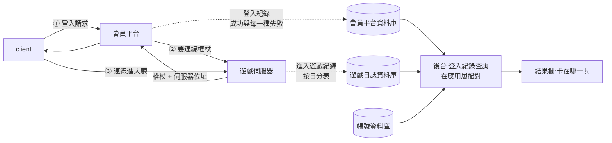

## 背景

一次登入要經過好幾段:第三方登入、會員平台、client、遊戲伺服器、遊戲內。任何一段出問題,所有人看到的都一樣:進不了遊戲,或跳出一句錯誤訊息。

觸發這個案子的是一件小事。營運同事在測試版 client 的載入畫面看到一句錯誤訊息,PM 第一個反應是來問後台:「這是不是會員平台傳的?」當下後台**沒有任何工具能回答**。那句錯誤字串不在任何一支後端程式裡,只可能來自 client 本身,但這件事要工程師逐支搜尋才能證明,PM 自己沒辦法判斷。於是只能每個部門都問一遍。

往下查,發現會員平台這一側的紀錄本身就不夠用:

- 登入紀錄表雖然有「是否成功」與「錯誤代碼」欄位,實際上**只有一種失敗會被寫進去**(第三方登入的權杖驗證失敗)。
- 遊戲伺服器拒絕登入或連不上時,會員平台**仍把那次登入記成成功**,失敗只留在應用程式的文字日誌裡。
- 工作階段無效、參數驗證失敗、建立帳號失敗,完全沒有資料庫紀錄。
- 用恢復碼登入的紀錄,**從上線至今一筆都沒有寫進去**。程式寫入的登入方式不在欄位允許的列舉值裡,資料庫是嚴格模式所以寫入丟例外,而例外被記錄服務自己的例外處理吞掉。測試與正式環境都是 0 筆,沒有人發現。

## 把問題拆成依序的關卡

「為什麼進不了遊戲」沒有人答得出來,是因為它不是一個問題,而是四個。拆開之後,每一關對應一個負責的部門:

| 關卡 | 發生什麼 | 卡在這裡時找誰 |
|---|---|---|
| 第 1 關 會員平台登入 | client 對會員平台的登入請求(帳號、工作階段、第三方權杖) | 後台(會員平台)、第三方、client 送的參數 |
| 第 2 關 取得遊戲連線 | 會員平台向遊戲伺服器要連線權杖與伺服器位址 | 遊戲伺服器團隊 |
| 第 3 關 進入遊戲 | client 拿權杖連上遊戲伺服器、進到大廳 | 過了第 2 關卻沒有第 3 關,是 client 與伺服器之間的連線協定 |
| 進入遊戲之後 | 大廳之後的流程 | 遊戲內功能 |

頁面上每一列是一次登入,結果欄直接寫「卡在會員平台登入」「卡在取得遊戲連線」「已取得連線未見進入遊戲」「已進入遊戲」。上線後,團隊照這四種結果定出了分工:卡在第一關找後台或 client;第二關是伺服器;能到第三關代表登入流程是通的,之後的錯誤屬於登入後的環節。

## 先修資料,再做頁面

查詢頁要能判斷「卡在第 2 關」,前提是第 2 關的失敗有被記下來。所以這個案子分成兩個變更,先上的是資料那一個:

- 會員平台的四支登入端點,**每一個失敗出口各寫一筆失敗紀錄**,錯誤代碼從 1 種補到 11 種。
- 遊戲伺服器拒絕或連不上時,改寫**同一筆**登入紀錄為失敗,附上伺服器回的代碼、訊息與請求編號。不另加一列,否則次數會重複,之後還得把兩列配對回來。
- client 收到的回應**逐字不變**:驗證失敗先寫紀錄、再丟出原本的例外;放進回應前把內部欄位拿掉,並用測試逐欄比對。
- 失敗紀錄只記欄位名稱、不記值,權杖、恢復碼、密碼一律不落地。
- 寫失敗紀錄這件事本身若失敗,只寫日誌、不影響登入回應。有一個測試是把登入紀錄表整張拿掉之後,確認登入 API 的回應不變。

舊資料不回填:先前被記成成功的那些,錯誤訊息當時根本沒有存,無從還原。

## 三台主機不能 JOIN

會員平台的登入紀錄、遊戲端的進入遊戲紀錄(按日分表、約保留 90 天)、帳號對照,分別在三台主機的三個資料庫,而且跨兩朵雲走公網。

| 設計 | 做法 |
|---|---|
| 合併 | 在應用層以帳號識別碼把三個來源串起來 |
| 只看單一來源 | 直接在資料庫分頁,畫面筆數可以直接對資料庫 |
| 看全部 | 兩邊整段撈回來配對;任一邊超過 20,000 筆就要求縮小範圍,不靜默截斷 |
| 查詢區間上限 | 90 天,對齊遊戲端日誌的保留期;查更長只會看到半邊資料 |
| 延遲 | 任何「每列查一次」都會被跨雲放大成秒級,抽屜需要的帳號對照改成整頁一次查 |

畫面合併之後,數字出問題會比兩個分頁各查一張表更難除錯。所以保留三樣東西:**來源篩選**、每一列可打開的**原始紀錄抽屜**(兩邊的原始欄位與配對方式),以及**可直接執行的查詢語句**。PM 看結果欄,工程師看抽屜。

## 配對規則是用真實資料訂的

兩邊沒有共同的請求編號,只能用帳號加時間配對。規則不是先想好的:

1. 先看測試環境的真實資料:同一次登入,兩邊的時間只差 0 到 1 秒。
2. 找到一個 client 連續重試的案例:會員平台在第 28、31、38 秒各有一筆,遊戲端在第 29、39 秒。據此把方向從「會員平台往後找」改成「**遊戲紀錄往前找最近一筆**」。
3. 為了容忍兩台主機的時鐘誤差,加了「之後 5 秒內也算」。單元測試立刻抓到問題:第 29 秒的遊戲紀錄配到了第 31 秒那筆,重試搶走了配對。
4. 定案:每筆遊戲紀錄先找**之前** 60 秒內最晚的一筆未配過的成功紀錄;沒有,才看**之後** 5 秒內最早的一筆。兩段不能混成一個時間窗。

配對邏輯抽成一個不碰資料庫的純函式,9 個單元測試。

## 測試環境驗出的三個問題

**機器人把真人淹沒。** 第一版上測試環境,一個角色半天十幾筆「只有遊戲紀錄」,約每 61 分鐘一筆,看起來像配對壞了。先查帳號身分:那是壓測機器人,直連遊戲伺服器、不經會員平台,占當天遊戲登入的 97%(923 筆裡 903 筆)。把真人單獨拉出來對帳,8 個帳號兩邊的筆數逐一相等。配對沒壞,是母體裡混了不該比的東西。兩邊對不起來的時候,先把母體分層再對帳,不急著改規則。

**查詢區間漏掉最後一天。** 查 90 天,第一頁有 39 筆「未見進入遊戲」,全是今天與昨天,但每一筆一秒後都有遊戲紀錄。根因在列出日分表的方法:它從起點逐日加一天,起點是下午 3:08,加到最後一天仍是下午 3:08,比終點的 3:07:59 晚,於是今天的分表被跳過。測試沒抓到,是因為測試的起點都是 00:00。修正後未配對剩 6 筆且都說得通,同一個查詢從 6 秒降到 1.4 秒。

**有帳號識別碼卻標成「未確定」。** 同批修正。

三個都修在根因之後才上正式環境。

## 資料驗證

- 動工前先實測前提:兩個環境的列舉值都缺恢復碼這一項、該登入方式都是 0 筆、資料庫都是嚴格模式,確認「從未被記錄」不是推測。
- 遊戲端日分表在兩個環境都剛好 93 張,據此確定保留期約 90 天。
- 第 2 關的失敗要怎麼在測試環境觸發:把遊戲伺服器端點暫時指向不存在的路徑,設定只壞了 **0.19 秒**就用備份還原並比對一致。
- 單一來源模式的筆數與匯出查詢語句的執行結果相等(657 對 657、33 對 33)。
- 扣掉機器人後,8 個真人帳號兩邊筆數逐一相等,當天 33 筆全部是「已進入遊戲」。

## 異常處理

| 情況 | 處理 |
|---|---|
| 會員平台資料庫連不上 | 「看全部」照樣回遊戲紀錄,並在表格上方提示會員平台資料暫時無法取得,不當成沒有紀錄 |
| 遊戲日誌資料庫連不上 | 回服務不可用。既有的「分表是否存在」檢查在連不上時會回「不存在」,兩者分不出來,所以這一頁另外檢查連線 |
| 合併或匯出超過上限 | 回錯誤並帶目前筆數與上限 |
| 寫失敗紀錄本身失敗 | 只寫日誌,不影響登入 |

## 後續:讓兩個系統之間的往來看得見

上線三週後,排查時又有兩個數字對不上。一是畫面上的 API 欄只有路徑,無法對照規格書;二是遊戲伺服器回的結果碼永遠顯示成遮罩。原因是那個欄位的名字剛好跟手機驗證碼相同,被一律遮掉了。

- 遮罩改成只套用在**請求**裡驗證碼的位置;回應裡同名的欄位是結果碼,顯示原值。
- 會員平台送給遊戲伺服器的參數、回應原文、狀態碼與耗時,存進登入紀錄的附加資料。權杖與簽章照樣遮,回應不是 JSON 時只存前 500 字。成功與失敗都存,且不會出現在給 client 的回應裡。
- API 欄對到規格書的索引名稱,在規格書裡搜尋就能找到那支端點。

在此之前,第 2 關出事只能請伺服器團隊翻他們的日誌。

## 關鍵取捨

| 取捨 | 選擇 | 理由 |
|---|---|---|
| 一張合併表 vs 兩個分頁各查一張 | **合併** | 兩個分頁的前提是使用者已經知道問題在哪一邊,而那正是他要問的 |
| 合併後怎麼除錯 | 保留來源篩選、原始紀錄抽屜、可執行查詢 | 合併會讓數字難追;單一來源的筆數必須能直接對資料庫 |
| 遊戲伺服器失敗 | 改寫同一筆 | 另加一列會讓次數重複,漏斗還得配對兩列 |
| 合併做在哪 | 應用層,設 20,000 上限 | 三台主機無法 JOIN;「依會員平台分頁再補遊戲紀錄」會漏掉沒配到的遊戲紀錄,總數也不對 |
| IP 查詢 | **不做** | 正式環境記到的 IP 不可用,而且使用者本來就不知道自己的 IP |
| 舊資料 | 不回填 | 當時沒存的錯誤訊息無法還原 |
| 表格的分頁與表頭 | 擴充共用元件,加選填設定 | 不在頁面自刻;沒給設定的 13 個既有頁面逐頁量測,行為不變 |

## 量化

| 項目 | 之前 | 之後 |
|---|---|---|
| 「這個登入錯誤是哪個部門的」 | 開單、描述操作、工程師翻三台主機的日誌 | 打開一頁,結果欄寫卡在哪一關 |
| 會被記錄的登入失敗 | 1 種 | 11 種,涵蓋四支端點的每個失敗出口 |
| 遊戲伺服器拒絕或連不上 | 記成成功 | 記成失敗,附代碼、訊息、請求編號 |
| 恢復碼登入紀錄 | 0 筆 | 正常寫入 |
| 90 天查詢(測試環境) | 6 秒 | 1.4 秒 |
| 自動化測試 | — | 會員平台 13 個功能測試;查詢頁 15 個 API 測試 + 9 個單元測試 |

> 跨系統的「為什麼失敗」先拆成依序的關卡,每一關對應一個負責的部門,再讓每一關都留下查得到的紀錄。頁面只是把關卡畫出來;真正的工作是讓那些紀錄存在。
