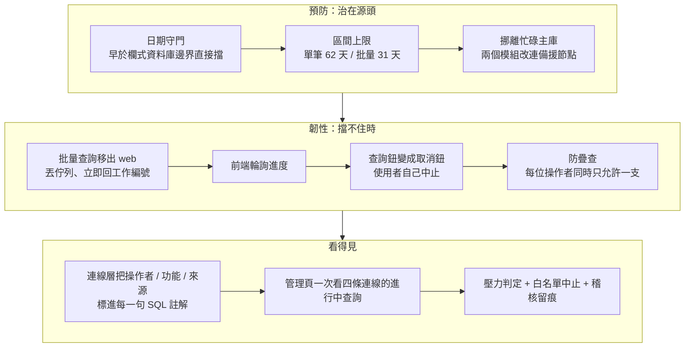

## 背景

風管有個習慣：把金流報表的查詢區間拉到很長，然後「放著跑」。

這個習慣會把正式環境的日誌資料庫掃到連線被切斷（約 15 分鐘），而且在那段時間裡**擠兌其他所有報表**。更麻煩的是，當下沒有任何人能處理——工程師不知道是誰在跑哪一支，應用程式帳號也沒有中止查詢的權限。

2026-09-16 在正式環境用執行計畫定位，找出唯一的重路徑：儲值與存摺查詢走的日分表聯集——**約 118 張表、每張 1,300～1,900 萬列，而且沒有玩家識別碼的索引**。一次長區間查詢要掃 **15～20 億列**。其餘模組都已走索引，不必動。

## 兩半：擋在源頭，與擋不住時能自救

這兩件事是分開的工程，但必須一起做——**只做預防，未知的重查詢還是會漏進來；只做自救，等於放任每次都要有人去救**。



## 預防層

**日期守門**：擋掉早於欄式資料庫資料邊界的查詢區間——那之前的資料不在欄式庫裡，只能回頭掃分表。邊界值走環境設定，不寫死。

**區間上限**：單筆查詢 **62 天**、批量 **31 天**。前端送出前先擋、後端再擋一次——前端擋是體驗，後端擋才是保證。

**挪離忙碌主庫**：兩個模組（轉帳紀錄與贈禮）改連備援節點。那是一個災難復原用的唯讀複本，平時閒置。單人兩個月的查詢實測從原本拖垮主庫變成 **23 秒**。

> 這裡有個取捨：備援節點的本職是災難復原，拿來跑報表會讓它的角色變得模糊。但實際評估後仍然採納——**閒置的複本與被擠兌的主庫，前者的風險小得多**，而且只挪了兩個唯讀模組。

## 韌性層

**批量查詢移出 web**：批量送出後丟進專用佇列、立即回一個工作編號，前端輪詢進度。查詢再慢也不再占著 web worker 與 HTTP 連線。

**使用者即時中止**：查詢進行中時，「查詢」按鈕換成「取消查詢」。按下去會對該查詢下 `KILL QUERY`——**只砍語句、保留連線**，而且因為是同一個帳號自己的查詢，不需要額外權限。

**防疊查**：每位操作者同時只允許一支在飛。已被砍掉的不算在內，否則使用者取消後會被自己擋住。

## 讓查詢「看得見、認得出人」

這是把前兩層串起來的關鍵：**在連線層把操作者、功能、觸發來源以 SQL 註解標進每一句查詢**。

```sql
/* op=<操作者> feat=<功能> via=<來源> */ SELECT ...
```

標記失敗時採 fail-open——標不上就照常送出，絕不因為標記而讓查詢失敗。

有了標記，管理頁才能回答「**這支是誰在跑哪張報表**」。在那之前，共用的對外 IP 讓人根本認不出是誰。

## 資料庫工作管理員

| 面向 | 之前 | 之後 |
|---|---|---|
| 看進行中查詢 | 找 DBA 翻程序清單 | 一頁看 **4 條連線**的即時快照 |
| 判斷資料庫忙不忙 | 無 | 現狀燈 🟢🟡🔴（三個全域狀態訊號） |
| 判斷「這支該不該砍」 | 憑經驗 | 壓力判定（即時秒數 vs 歷史 p90 ＋ 鎖等待 ＋ 效率旗標） |
| 砍查詢 | 應用程式帳號無權，不敢砍 | 白名單中止，排程與遊戲端寫入自動擋下 |
| 砍完追責 | 共用 IP 認不出人 | 稽核紀錄帶操作者中文名與 SQL 片段 |

**白名單而不是黑名單**：排程不可砍、遊戲端與非後台的寫入不可砍、唯讀的定期輪巡豁免。預設拒絕、明確放行。

**降級不崩頁**：若缺少效能結構描述的查詢權限，重量欄回空值、壓力判定退回使用程序清單的執行秒數，整頁照常運作。

## 最痛的坑：想量「這支查詢占多少資源」，但量不到

兩版設計都想做一個「記憶體占比 %」欄位，怎麼刷都出不來。

根因是資料庫版本——**per-query 記憶體儀表是 MySQL 5.7.2 才加入的能力**，更早的版本物理上取不到；而另一個看似可用的程序清單記憶體欄位是 MariaDB 專有，不是 MySQL。

解法是**把題目換掉**：占比 % 整個移除，改成「**壓力判定**」。在該版本上，對進行中查詢唯一即時的 per-query 訊號只有語句計時器的累計等待時間，所以判定改用「即時秒數相對於該類查詢歷史 p90」加上鎖等待與效率旗標，輸出 🔴 建議砍／🟡 觀察／正常。

> 這個坑的教訓不是「5.6 很爛」，而是：**當物理上拿不到某個指標時，正確的動作是換一個能回答同一個決策問題的指標，而不是繼續想辦法硬湊那個數字。** 使用者真正要的從來不是「占多少 %」，是「**這支該不該砍**」。

## 另外三個坑

**中止砍不掉「探測迴圈」型的重報表**。有些報表不是在跑一句長查詢，而是在迴圈裡逐張探測分表是否存在——執行緒多數時間在等應用程式算下一句，中止訊號落不到任何一句語句上。這同時解釋了為什麼要把探測批次化。

**佇列的預設重試窗會造成重複執行**。報表類工作單次就可能跑數十分鐘，而預設的重派時間遠短於此——工作還在跑就被判定逾時重派，於是同一支重查詢同時跑兩份。重試窗必須配合實際工作長度調整，並把重試次數設為 1。

**文件落後程式碼，導致條件過濾出現假陰性**。依文件寫的判斷條件在實際資料上命中不到，而且是靜默的——這類「查不到」的結論，一定要換第二種方式交叉驗證過才能採信。

## 量化

| 指標 | 改善前 | 改善後 |
|---|---|---|
| 長區間金流查詢 | 掃 **15～20 億列** → 連線被切（約 15 分）＋ 擠兌其他報表 | 守門與上限擋在輕量範圍；批量移出 web；可即時中止 |
| 分表存在性探測 | 逐張探測迴圈 **約 52 秒** | 一句系統結構描述查詢 |
| 砍重查詢 | 砍不掉（執行緒在等應用程式；自動重連又救回來） | 使用者一鍵中止，同帳號免額外權限 |
| 兩個月區間的贈禮查詢 | 拖垮忙碌主庫 | 改連備援節點，實測 **23 秒** |
| 大範圍機台查詢 | 綁定參數過多而失敗 | 隨探測批次化一併解掉 |

## 關鍵取捨

| 取捨 | 選擇 | 理由 |
|---|---|---|
| 擋在源頭 vs 事後救 | **兩者都要** | 只擋源頭會漏掉未知的重查詢；只做自救等於每次都要有人去救 |
| 全部報表走非同步 vs 只有批量 | **只有批量** | 單筆查詢在上限內已經夠快，全面非同步會讓所有報表都變成輪詢，體驗退步 |
| 挪整個模組到備援 vs 只挪兩個 | **只挪兩個** | 備援節點的本職是災難復原，挪越多風險越大；只挪實測最重的兩個唯讀模組 |
| `KILL` vs `KILL QUERY` | **`KILL QUERY`** | 只砍語句保留連線，連線池不會因此破洞 |
| 占比 % vs 壓力判定 | **壓力判定** | 前者在該資料庫版本物理上拿不到；後者回答的是同一個決策問題 |
| 探測迴圈保留回退路徑 | **保留** | 批次查詢若因權限或版本失效，仍要能退回逐張探測，不能整頁掛掉 |
